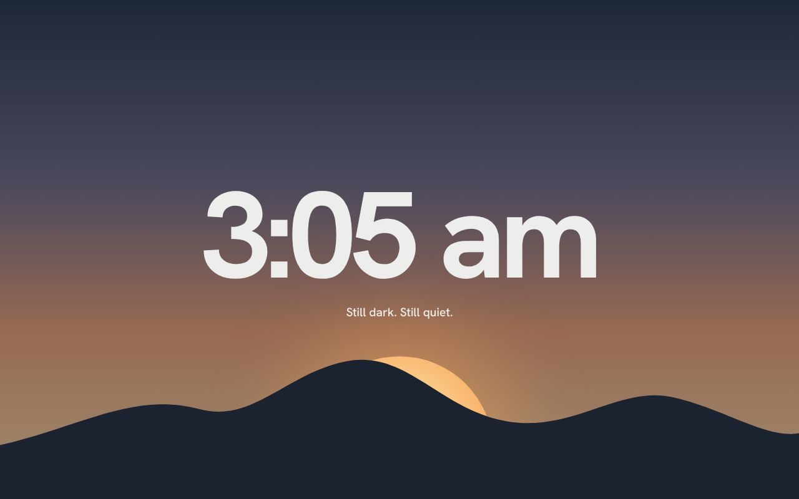
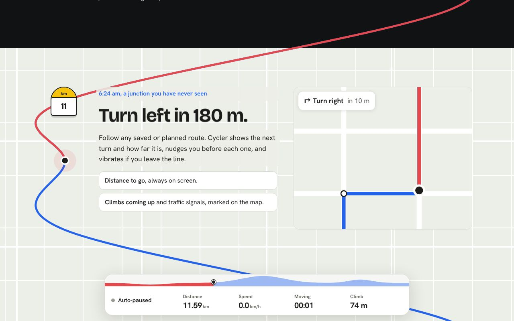

# Cycler landing page

The website for [Cycler](https://github.com/Kunj-Company/cycler), a personal cycling app for Android:
record rides, plan routes and look back on every ride, with no account, no cloud and no ads.


The page tells one morning loop, from planning it the night before to looking back on it weeks
later. Scrolling is riding: the planned route is drawn in blue, your scroll records it in red, and
a ride bar at the bottom counts distance, speed, moving time and climb. Stop scrolling and it
auto-pauses, the way the app does.

| The night passes | A junction, played by scroll | Share cards |
|---|---|---|
|  |  |  |

## Run it

It is a static site with no build step and no dependencies to install.

```sh
git clone https://github.com/Kunj-Company/cycler-landing-page.git
cd cycler-landing-page
python3 -m http.server 8000
```

Then open <http://localhost:8000>. Opening `index.html` straight from disk works too.

## Deploy

Any static host works with the repository root as the output folder and no build command:
Vercel, Cloudflare Pages, Netlify or GitHub Pages. `404.html` is picked up automatically by all four.

Two things need the final domain once it is known:

- `og:image` in `index.html` is a relative path. Most link previews want an absolute URL.
- `404.html` uses root-relative paths, so it assumes the site sits at the root of its domain.

## Layout

| Path | What |
|---|---|
| `index.html` | The page markup, in story order |
| `css/styles.css` | Design tokens and all styles |
| `js/main.js` | Scroll-ride logic, the demos, and the GSAP choreography |
| `404.html` | Self-contained "you have left the route" page |
| `img/` | App logo, icons, social preview and screenshots |
| `site.webmanifest`, `robots.txt` | Browser and crawler metadata |
| `docs/DESIGN.md` | The concept, tokens, sections and motion inventory |

## How it is built

- **No framework.** One HTML file, one stylesheet, one script.
- **Scroll-ride.** A single SVG path is laid through the ride chapters from their layout
  positions. Scroll position maps to a length along it, which drives the red track, the rider dot,
  the kilometre stones and the ride bar.
- **Motion.** [GSAP](https://gsap.com) 3.12.5 and ScrollTrigger, loaded from cdnjs. Details are in
  [docs/DESIGN.md](docs/DESIGN.md).
- **Fallback.** With reduced motion turned on, or if GSAP does not load, every section is visible
  and static. The scroll-ride itself needs no library.
- **Type.** Bricolage Grotesque and Hanken Grotesk from Google Fonts.

## Content

Feature descriptions, the privacy list and version details follow the Cycler
[README](https://github.com/Kunj-Company/cycler#readme) and
[changelog](https://github.com/Kunj-Company/cycler/blob/main/CHANGELOG.md), currently 0.1.12.

Some things on the page are illustrations, and the page says so where it matters:

- The loop planner draws sketched loops. The app routes on real roads with BRouter.
- The activity week, segment times and bike-care numbers are sample data.
- The times of day, the tea stall and the weather values are story details.

## Contributing

Corrections and improvements are welcome. See [CONTRIBUTING.md](CONTRIBUTING.md).

## Licence

Copyright (C) 2026 Abhiram N J

This site is free software, licensed under the
[GNU Affero General Public License v3.0](LICENSE). If you publish a modified version, you must
make its source available under the same licence.

Not covered by that licence:

- The Cycler app is a separate project under the MIT licence.
- The app logo and screenshots in `img/` come from the Cycler repository.
- GSAP and the two typefaces are loaded from their own hosts under their own licences.
- Maps in the screenshots are © OpenStreetMap contributors.
