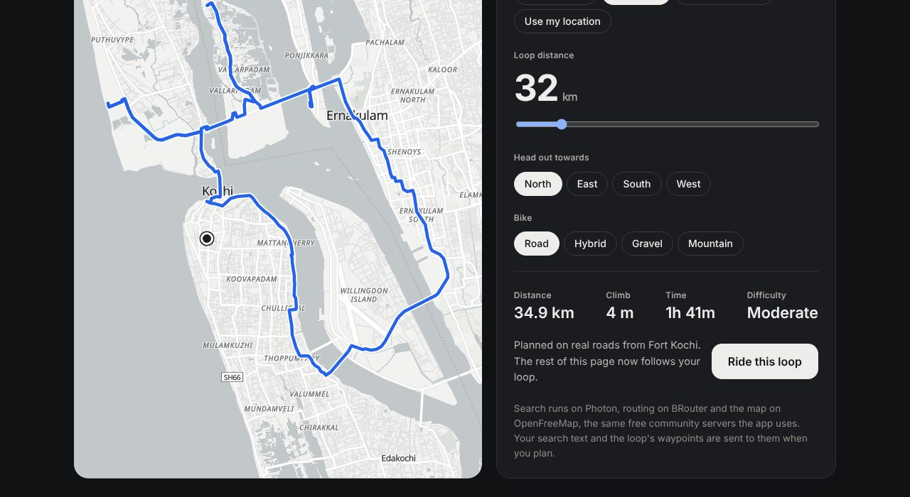

# Cycler landing page

The website for [Cycler](https://github.com/Kunj-Company/cycler), a personal cycling app for Android:
record rides, plan routes and look back on every ride, with no account and no ads, rides kept on the phone, and anonymous usage stats that can be turned off.


The page tells one morning loop, from planning it the night before to looking back on it weeks
later. Scrolling is riding: the planned route is drawn in blue, your scroll records it in red, and
a ride bar at the bottom counts distance, speed, moving time and climb. Stop scrolling and it
auto-pauses, the way the app does.



The planner is live. It opens on a loop from Thattekad Bird Sanctuary in Kerala; search a place
and it routes a real loop there, which the rest of the page then follows.

| The night passes | A junction, played by scroll | Share cards |
|---|---|---|
|  |  |  |

## Run it

It is a static site with no build step and no dependencies to install.

```sh
git clone https://github.com/Kunj-Company/cycler-landing-page.git
cd cycler-landing-page
python3 -m http.server 8000
```

Then open <http://localhost:8000>. Opening `index.html` straight from disk works too.

## Deploy

The site is at <https://cycler.kunj.company>. The Vercel address <https://cycler-landing-page.vercel.app> keeps working. It is a Vercel project linked to this repository: every push to
`main` is deployed to production, and other branches get preview URLs.

Any static host works with the repository root as the output folder and no build command:
Vercel, Cloudflare Pages, Netlify or GitHub Pages. `404.html` is picked up automatically by all four.

`404.html` uses root-relative paths, so it assumes the site sits at the root of its domain.

## Search, answer engines and AI assistants

What is in place:

- **Search (SEO).** Title, meta description, canonical URL and Open Graph and Twitter tags on every
  indexable page, with a 1200x630 preview image. `sitemap.xml` with `lastmod`, and `robots.txt`
  pointing at it. `404.html` is `noindex`. The old `cycler-landing-page.vercel.app` address
  redirects permanently (308) to `cycler.kunj.company`, so there is one canonical site; preview
  deployments are not affected.
- **Structured data (JSON-LD).** Home: `WebSite`, `Organization`, `Person`,
  `SoftwareApplication`/`MobileApplication` (version, free offer, licence, Android requirement,
  APK file type, features, screenshots, keywords, `dateModified`), an `FAQPage` that mirrors the
  visible FAQ exactly, and a `HowTo` for installing. Privacy and terms: `WebPage` with a
  `BreadcrumbList`. All `@id`s are absolute URLs.
- **Answer engines (AEO).** The FAQ opens with "What is Cycler?" and "How do I install Cycler?",
  each answered in its first sentence. All content is plain HTML in the markup, not injected by
  script.
- **AI assistants and generative search (GEO).** `robots.txt` names the AI crawlers (OpenAI,
  Anthropic, Perplexity, Google-Extended, Apple, Bing, DuckDuckGo, Mistral, Common Crawl) and
  allows them. `llms.txt` is the short summary and `llms-full.txt` the whole site as plain
  markdown (key facts, every feature, install steps, every FAQ). The home page links both with
  `rel="alternate"`. They are served as UTF-8 plain text.
- **Speed.** Fonts (`fonts/`, preloaded) and GSAP (`js/vendor/`) are self-hosted with a one-year
  immutable cache; only the planner's map library comes from cdnjs, and only when you reach it.
  Scripts are deferred.
- **Accessibility.** One `h1`, section `h2`s, landmarks, a skip link, alt text and sizes on every
  image, lazy loading below the fold. Lighthouse: SEO, accessibility and best practices 100.
- `/.well-known/security.txt` with a contact address (renew its `Expires` line yearly).

No ratings or reviews are marked up, because the app has none to cite.

After changing the FAQ or the feature list, keep the JSON-LD `FAQPage` in step with the visible
FAQ, and update `llms-full.txt`, which repeats both.

### Domain

The site's address is <https://cycler.kunj.company>. The canonical URL, `og:url`, the absolute `og:image` and
`twitter:image`, the JSON-LD URLs and `sitemap.xml` all use it. If the domain ever changes, search
for `cycler.kunj.company` and replace it everywhere, then submit the new address in Google Search
Console and Bing Webmaster Tools.

When the app version changes, update `softwareVersion` and `dateModified` in the JSON-LD, the APK
name and version in the install section, the feature list heading, `llms.txt`, `llms-full.txt`
and the `lastmod` dates in `sitemap.xml` together.

## Layout

| Path | What |
|---|---|
| `index.html` | The page markup, in story order |
| `css/styles.css` | Design tokens and all styles |
| `js/default-loop.js` | The stored default loop: place, settings and the routed track |
| `js/main.js` | The ride model, the planner, scroll-ride logic, the demos, and the GSAP choreography |
| `js/stats.js` | Cookie-free visit-count beacon (see [Visit counts](#visit-counts)) |
| `404.html` | Self-contained "you have left the route" page |
| `img/` | App logo, icons, social preview and screenshots |
| `site.webmanifest`, `robots.txt`, `sitemap.xml`, `llms.txt`, `llms-full.txt`, `.well-known/security.txt` | Browser, crawler and AI-assistant metadata |
| `fonts/`, `css/fonts.css`, `js/vendor/` | Self-hosted typefaces and GSAP |
| `privacy.html`, `terms.html`, `css/legal.css` | Privacy policy and terms of service |
| `vercel.json` | Security headers, cache rules and the vercel.app redirect |
| `analytics-worker/` | The visit-count collector (Cloudflare Worker + D1) and the laptop Metabase pipeline |
| `docs/DESIGN.md` | The concept, tokens, sections and motion inventory |

## How it is built

- **No framework.** One HTML file, one stylesheet, one script.
- **A working planner.** Search a place, pick a distance, direction and bike, and the page routes
  a real round trip the way the app does: Photon finds the place, BRouter routes a circle of
  waypoints on real roads, and MapLibre draws it on OpenFreeMap tiles. The loop then becomes the
  ride the rest of the page tells: distance, climb, time, elevation profile, kilometre stones,
  share cards, flyover and ticker all follow it.
- **Scroll-ride.** A single SVG path is laid through the ride chapters from their layout
  positions. Scroll position maps to a length along it, which drives the red track, the rider dot,
  the kilometre stones and the ride bar.
- **Motion.** [GSAP](https://gsap.com) 3.12.5 and ScrollTrigger, self-hosted in `js/vendor/` (byte-identical to cdnjs, checked against its SRI hashes). Details are in
  [docs/DESIGN.md](docs/DESIGN.md).
- **Fallback.** With reduced motion turned on, or if GSAP does not load, every section is visible
  and static. The scroll-ride itself needs no library.
- **Type.** Bricolage Grotesque and Hanken Grotesk (OFL), self-hosted in `fonts/` (variable, latin and latin-ext) with `css/fonts.css`; the two latin files are preloaded.

## Services the planner calls

The same free community servers the app uses, with no API keys. The default loop is stored with
the page, so the planner calls nothing on load. Map tiles and the weather line load when the planner
scrolls into view; search and routing run only when a visitor plans a loop.

| What | Service | Sent |
|---|---|---|
| Place search | Photon (photon.komoot.io) | The search text, and the last chosen place rounded to about 1 km |
| Routing | BRouter (brouter.de) | Five waypoints of the loop and the bike profile |
| Map | OpenFreeMap, drawn by MapLibre GL JS 4.7.1 from cdnjs | The tiles viewed |
| Weather line | Open-Meteo | The chosen place rounded to about 100 m |

These are shared servers, so the page goes easy on them: search waits for a pause in typing,
routing runs once per change, an earlier request is cancelled when a new one starts, and results
are cached for the visit. If the map cannot load, the route is drawn as a shape instead. If
routing fails, the planner says why and offers a retry.

## Visit counts

`js/stats.js` is a small first-party beacon loaded by every page. It sets no cookies and stores
nothing in the browser. It sends a `pageview` on load, and on click `download` (GitHub releases),
`beta` (Tally), `donate` (Buy Me a Coffee), `source` (other links to the Cycler repositories) and
`card` (the share card's download button). Each event is a small JSON body with the event name,
the page URL, the referrer and the window width, sent with `sendBeacon`.

- It only runs on `cycler.kunj.company` and `cycler-landing-page.vercel.app`, so local previews
  send nothing, and it skips automated browsers (`navigator.webdriver`).
- The endpoint is the `URL_` constant at the top of the file. It still holds the placeholder
  `hi-480`; replace it with the account's workers.dev subdomain, and do the same in
  the `connect-src` entry of the Content-Security-Policy in `vercel.json`.
- To leave your own visits out, run this once in the browser console on the live site:
  `localStorage.setItem('cycler_stats_ignore','1')`. Remove the key to be counted again.
- The receiving Cloudflare Worker and its D1 database live in `analytics-worker/`. What is
  counted and kept is described in the [privacy policy](privacy.html#webstats).

## Content

Feature descriptions, the privacy list and version details follow the Cycler
[README](https://github.com/Kunj-Company/cycler#readme) and
[changelog](https://github.com/Kunj-Company/cycler/blob/main/CHANGELOG.md), currently 0.1.13.

Some things on the page are illustrations, and the page says so where it matters:

- The page opens on a real loop from Thattekad Bird Sanctuary, routed once with BRouter and stored
  in `js/default-loop.js`. Planning your own replaces it.
- The activity week, segment times and bike-care numbers are sample data.
- The times of day and the tea stall are story details.

## Contributing

Corrections and improvements are welcome. See [CONTRIBUTING.md](CONTRIBUTING.md).

## Licence

Copyright (C) 2026 Abhiram N J

This site is free software, licensed under the
[GNU Affero General Public License v3.0](LICENSE). If you publish a modified version, you must
make its source available under the same licence.

Not covered by that licence:

- The Cycler app is a separate project under the MIT licence.
- The app logo and screenshots in `img/` come from the Cycler repository.
- GSAP (standard GSAP licence, free) and the two typefaces (SIL Open Font License 1.1) are self-hosted under their own licences.
- Maps in the screenshots are © OpenStreetMap contributors.
